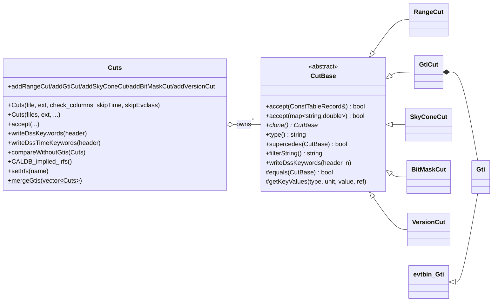

# dataSubselector Architecture

**dataSubselector** is two things:

1. A **library** of event selections ("cuts") and the code that encodes
   them as **DSS (Data Subspace) keywords** in FITS headers. This is how
   every downstream tool knows which energy range, region, zenith cut,
   event class/type and GTIs a data set has. The full contract is in
   [dss-keywords.md](dss-keywords.md).
2. Three tools:
   - **`gtselect`** filters FT1 events by cone, time, energy, zenith
     angle, event class/type, conversion type and pulse phase.
   - **`gtmktime`** builds GTIs from an FT2 filter expression and applies
     them to an FT1 file.
   - **`gtvcut`** prints the DSS keywords of a file.

The Doxygen mainpage (`src/mainpage.h`) describes the DC1-era tool ("cuts
on data extracted from the D1 Database by the U1 Tool", columns like
`IMGAMMAPROB`). It is obsolete. Use `pfiles/*.par` and the sources as the
source of truth.

## Purpose and scope

**Does:**
- Represent selections as `CutBase` objects: ranges on columns, sky cones,
  GTIs, bit masks on `EVENT_CLASS`/`EVENT_TYPE`, and IRF version tags.
- Apply them row by row (`accept`) or turn them into a cfitsio row-filter
  string (`filterString`).
- Read and write DSS keywords; combine, merge and compare cut sets across
  files.
- Infer the IRF name from the event-class/type DSS keywords and CALDB
  (`Cuts::CALDB_implied_irfs`), and the reverse (`Cuts::setIrfs`).
- Represent GTIs (`dataSubselector::Gti`, a thin subclass of `evtbin::Gti`)
  and write `GTI` extensions.

**Does not:**
- Bin data (`evtbin`) or compute exposure or livetime (`Likelihood`).
- Load IRFs. It only reads `irf_index.fits` and the validity-mask files
  from CALDB to translate between names and bit masks.
- Support DSS selections with a functional form (e.g.
  `ZENITH_ANGLE(ENERGY)`). The `Cuts` constructor documents this.

## Position in the system

| Direction | Package | Why |
|-----------|---------|-----|
| Depends on | `tip` | All FITS headers and tables; `Gti` uses raw cfitsio (`fits_create_tbl`) to add a missing `GTI` HDU. |
| Depends on | `evtbin` | `dataSubselector::Gti` **derives from `evtbin::Gti`**, so interval storage, `|`, `&`, `computeOntime` and equality are evtbin's. See `src/evtbin/doc/architecture/`. |
| Depends on | `astro` | `SkyDir` for `SkyConeCut`. |
| Depends on | `irfs` (`irfUtil`) | `irfUtil::EventTypeMapper` in `Cuts::append_event_type_partition`. |
| Depends on | `st_facilities`, `facilities` | `Environment::getEnv("CALDB")`, `Util::readLines`, `Util::expectedException`, `FitsUtil::fcopy`/`writeChecksums`, `commonUtilities::joinPath`, `Util::stringTokenize`. |
| Depends on | `st_stream` | Warnings in `Cuts` and `BitMaskCut`. Not in `target_link_libraries`; it arrives through `evtbin`'s PUBLIC links. |
| Depends on | `st_app`, `hoops` | Tools only (`StApp`, `AppParGroup`, catching `hoops::Hexception` for `INDEF`). Also arrive transitively through `evtbin`. |
| Used by | `Likelihood` | Heavy user: `Cuts`, `RangeCut`, `GtiCut`, `SkyConeCut`, `BitMaskCut`, `Gti`. `RoiCuts` wraps a `Cuts`; `AppHelpers` checks DSS consistency between FT1, livetime cube, exposure and counts maps, and infers IRFs. Writes DSS into counts maps, exposure maps, livetime cubes. |
| Used by | `pyLikelihood` | SWIG `%include`s `CutBase.h`, `BitMaskCut.h`, `Cuts.h` (the `#ifndef SWIG` parts are hidden). `UnbinnedAnalysis.py`/`BinnedAnalysis.py` call `pyLike.Cuts(...).CALDB_implied_irfs()`. |
| Used by | `observationSim` | `obsSim` builds a `Cuts` (energy, cone, `setIrfs`, event type); `EventContainer` filters simulated events with `accept(map)` and writes DSS/GTI into the FT1. |
| Used by | `rspgen` | Reads the `SkyConeCut` from the PHA `SPECTRUM` header. |
| Used by | `pyExposure` | `gtexposure` reads the cone and energy cuts from a light curve. (`pyExposure.i` would expose `CutBase`, `Gti`, `GtiCut`, `RangeCut`, `SkyConeCut` and `Cuts`, but that SWIG module is not built.) |
| Used by | `SolarSystemTools` | `Cuts`, `Gti` in `gtltsumsun`, `gtexpcubesun`, `gtexphpsun`. Not linked directly; arrives through `Likelihood`. |
| Link only | `sane` | `test_sane` links it; no C++ use. `sane/python/gt_apps.py` wraps `gtselect` (`filter`) and `gtmktime` (`maketime`) as tools. |
| Unbuilt sources | `fitsGen`, `map_tools` | `fitsGen`'s `makeFT1`, `partition`, `convertFT1`, `egret2FT1` and `map_tools`' `exposure_map` include dataSubselector headers, but CMake builds none of them. |

**CMake linkage vs. use:**
`target_link_libraries(dataSubselector PUBLIC astro evtbin tip PRIVATE
st_facilities facilities irfLoader irfInterface irfUtil CLHEP::VectorS)`.
`irfLoader`, `irfInterface` and `CLHEP::VectorS` are **not used** by the
library or tools (only the unbuilt `gtalign` uses CLHEP). `st_stream`,
`st_app` and `hoops` are used but come only transitively from `evtbin`.

## Key abstractions



| Class | `type()` | Role |
|-------|----------|------|
| `CutBase` | — | Template-method base. `operator==` is non-virtual and calls `type()` + `equals()`. `writeDssKeywords`/`writeCut` call the subclass's `getKeyValues`. Default `supercedes` is `false`, default `filterString` is `""`. |
| `RangeCut` | `"range"` | Range on a scalar column or one element of a vector column (`COL[i]`, 1-based). `CLOSED`, `MINONLY`, `MAXONLY`. **Half-open `(min, max]`**; when `min == max` it is closed `[v, v]` so a single value (e.g. `CONVERSION_TYPE`) can be selected. |
| `GtiCut` | `"GTI"` | Holds a `Gti`; accepts on the `TIME` column. `filterString()` is empty (the tools add `gtifilter()` themselves). |
| `SkyConeCut` | `"SkyCone"` | Cone on the `RA`/`DEC` columns (hard-coded names). `accept` uses `≤ radius`; `filterString` uses `angsep(RA,DEC,ra,dec) < radius`. |
| `BitMaskCut` | `"bit_mask"` | `(value & mask) != 0` on `EVENT_CLASS` or `EVENT_TYPE`. Pass 8+ filter string is `((COL&o<octal>) != o0)`; pre-Pass 8 is `((COL/mask)%2 == 1)`. Holds static "validity mask" tables, loaded from CALDB, that decide whether a new class/type selection may replace an existing one. |
| `VersionCut` | `"version"` | Not a selection: carries `IRF_VERSION` into derived files. Always accepts. |
| `Cuts` | — | Owning container of `CutBase*`. Reads/writes DSS keywords, applies all cuts (logical AND), merges/compares sets, IRF-name logic. The public API other packages use. |
| `Gti` | — | `evtbin::Gti` plus `accept`/`accept2`, `writeExtension(file)`, `applyTimeRangeCut`, `minValue`/`maxValue`. |
| `CutController` (`src/dataSubselector/`, private to `gtselect`) | — | Singleton that turns `gtselect` parameters into a `Cuts` and a filter string. |

## Data flow and control flow

### `gtselect` (`src/dataSubselector/dataSubselector.cxx`, `CutController.cxx`)

```
DataFilter::run
  prompt infile, outfile, ra/dec/rad (INDEF → rad=180 = no cone),
         tmin/tmax (INDEF → 0,0 = no time cut), emin, emax, zmin, zmax
  resolve_fits_files(infile)                  // @list or single file
  CutController(pars, files, evtable)
    Cuts(files, evtable, check_columns=true, skipTimeRangeCuts=true)
        // existing DSS from every file; must match (except GTIs); GTIs unioned
    checkPassVersion: every file's EVENTS header must have the same PASS_VER (else throw)
    add cone (rad < 180), TIME (unless 0,0), ENERGY (unless 0,0),
        CONVERSION_TYPE (convtype ≥ 0), EVENT_CLASS bit mask (evclass not INDEF),
        EVENT_TYPE bit mask (evtype not INDEF; pre-P8: evtype 1/2 → convtype 0/1),
        ZENITH_ANGLE (zmin > 0 or zmax < 180), PULSE_PHASE (≠ 0..1)
    mergeRangeCuts()                           // intersect ranges per column
  filter = cuts.filterString() + " && gtifilter()"
  1 file : FitsUtil::fcopy(in[EVENTS][filter] → out)   // cfitsio copies all HDUs
  N files: fcopy the first, then append filtered rows of the others through tip
  writeDssKeywords(EVENTS header) + HISTORY "Filter string: …"
  copyGtis: union of the input GTIs → out[GTI]
  updateGti: intersect out[GTI] with the TIME range → out[GTI] (ONTIME updated)
  if a time cut or several inputs: TSTART/TSTOP/DATE-OBS/DATE-END in PRIMARY, EVENTS, GTI
  writeChecksums
```

User-facing parameter help is in `fermitools-fhelp` (`gtselect.txt`).

### `gtmktime` (`src/gtmaketime/gtmaketime.cxx`)

```
MakeTime::run
  Prompt all; check outfile/clobber
  findTimeLims: TSTART/TSTOP of evfile[evtable]
  createGti:
    filter = par "filter" (+ roiZenAngleCut() if roicut=yes)
    for each FT2 file (@list ok): rows = FT2[sctable][filter]  (cfitsio row filter)
       zero rows → throw
       skip rows with STOP ≤ TSTART; stop at first row with START > TSTOP
       join rows whose START == previous STOP exactly; union into m_gti
  mergeGtis:
    overwrite=no : m_gti &= GTI from the FT1 DSS (TIME/TABLE) keyword
    overwrite=yes: m_gti &= [tstart, tstop] (or header TSTART/TSTOP if header_obstimes=yes)
  copyTable:
    write m_gti to a temp file (gtifile, default "<outfile>_tempgti")
    fcopy(evfile[evtable][gtifilter("<tempfile>")] → outfile)
    outfile[GTI] ← m_gti; checksums; delete temp file
  updateKeywords: FILENAME in primary
```

**ROI-based zenith cut** (`roicut=yes`): reads the FT1 DSS keywords. If
there is a `ZENITH_ANGLE` range with `zmax < 180` **and** a cone, it appends
`&& angsep(RA_ZENITH,DEC_ZENITH,ra,dec) < zmax − radius` to the FT2 filter.
FT2 intervals during which any part of the ROI could be beyond `zmax` are
dropped. `zmin` is ignored. If either keyword is missing it prints an info
message and applies nothing extra.

The DSS keywords are copied unchanged by `fcopy`. The new GTI is
referenced by the existing `TIME`/`TABLE`/`:GTI` entry. `gtmktime` does not
update `TSTART`/`TSTOP` or record its filter expression in the header.

### `gtvcut` (`src/viewCuts/viewCuts.cxx`)

`Cuts(infile, table, check_columns=false).writeCuts(std::cout,
suppress_gtis)`. Works on any HDU with `NDSKEYS`, including images.

## Public interfaces

### Applications

| Tool | Par file | Notes |
|------|----------|-------|
| `gtselect` | `pfiles/gtselect.par` | Asked: `infile`, `outfile`, `ra`, `dec`, `rad`, `tmin`, `tmax`, `emin`, `emax`, `zmax`. Hidden: `zmin`, `evclass`, `evtype`, `convtype`, `phasemin`, `phasemax`, `evtable=EVENTS`. `INDEF` in any of `ra/dec/rad` disables the cone; in either `tmin/tmax`, the time cut; `evclass`/`evtype` `INDEF` = no bit-mask cut. |
| `gtmktime` | `pfiles/gtmktime.par` | `scfile`, `filter` (default `DATA_QUAL>0 && LAT_CONFIG==1 && ABS(ROCK_ANGLE)<52`), `roicut`, `evfile`, `outfile`. Hidden: `sctable`, `evtable`, `apply_filter`, `overwrite`, `header_obstimes`, `tstart`, `tstop`, `gtifile`. |
| `gtvcut` | `pfiles/gtvcut.par` | `infile`, `table=EVENTS`, `suppress_gtis=yes`. |
| *(gtalign)* | `pfiles/gtalign.par` | **Not built.** Sources in `src/gtalign/` (applies boresight-alignment rotations to FT1), but there is no `add_executable`. The par file is still installed into `syspfiles`. |

All three tools use the `st_app` framework; see `src/st_app/doc/architecture/`
for startup, the exit-status contract and the standard hidden parameters,
and `src/ape/doc/architecture/parameter-files.md` for par-file handling.

### C++ library

Headers in `dataSubselector/`: `Cuts.h`, `CutBase.h`, `RangeCut.h`,
`GtiCut.h`, `SkyConeCut.h`, `BitMaskCut.h`, `VersionCut.h`, `Gti.h`.
`Cuts.h` and `Gti.h` are by far the most used. `CutController.h` is private
to `gtselect` and not installed.

Idiomatic use:

```cpp
// What cuts were applied to an FT1 file?  (Table HDU: check columns.)
dataSubselector::Cuts cuts("ft1.fits", "EVENTS");
// For an image HDU (counts map, exposure map), never check columns:
dataSubselector::Cuts mapCuts("cmap.fits", "", false);

// Check consistency between two products (non-GTI cuts only).
if (!cuts.compareWithoutGtis(mapCuts)) { /* mismatch */ }

// Copy selections to a new product.
cuts.writeDssKeywords(outTable->getHeader());
cuts.writeGtiExtension("out.fits");

// bitMaskCut() returns a NEW copy (caller deletes, or hands it to setBitMaskCut):
std::unique_ptr<dataSubselector::BitMaskCut> evclass(cuts.bitMaskCut("EVENT_CLASS"));
```

### Python

No module of its own. `pyLikelihood` exposes `Cuts` and `BitMaskCut` as
`pyLike.Cuts` etc.; `pyExposure` exposes `CutBase`, `Gti`, `GtiCut`,
`RangeCut`, `SkyConeCut` and `Cuts`. `sane.gt_apps` wraps `gtselect` and `gtmktime` as tools.

### Environment variables

| Variable | Where | Effect |
|----------|-------|--------|
| `CALDB` | `Cuts(file, …)` constructor (once per process), `Cuts::read_bitmask_mapping`, and `irfUtil::EventTypeMapper` | Reads `$CALDB/data/glast/lat/bcf/valid_evclass_selections.txt`, `valid_evtype_selections.txt` and `irf_index.fits`. Set by conda activation; see "Runtime environment" in `docs/architecture/README.md`. |

There are no direct `getenv` calls; `CALDB` is read through
`st_facilities::Environment::getEnv`.

### File formats

- **FT1** (`EVENTS` + `GTI`): read and written by `gtselect`/`gtmktime`.
  The `EVENTS` header must have `PASS_VER` for `gtselect` and `NDSKEYS`
  for anything that builds a `Cuts` from it.
- **FT2** (`SC_DATA`): read by `gtmktime` (`START`, `STOP` and whatever
  columns the filter uses, plus `RA_ZENITH`/`DEC_ZENITH` for `roicut`).
- **DSS keywords** in any HDU: see [dss-keywords.md](dss-keywords.md).
- **GTI** extension: `START`, `STOP` (`D`, unit `s`) and `ONTIME`.

## Build and test

- **CMake targets:** `dataSubselector` is a **STATIC** library (built PIC,
  linked into shared libraries such as `Likelihood`'s). Executables:
  `gtselect`, `gtmktime`, `gtvcut`, `test_dataSubselector`.
- **Install:** headers → `include/dataSubselector`; `pfiles/` →
  `syspfiles` (including the unused `gtalign.par`); `data/` →
  `${FERMI_INSTALL_REFDATADIR}/dataSubselector`, i.e.
  `refdata/fermi/dataSubselector`, which is where
  `getDataPath("dataSubselector")` looks.
- **`test_dataSubselector`** (`src/test/test.cxx`):
  - A CppUnit `TextTestRunner` program with 17 tests in `DssTests`. It is
    **not registered with CTest**. Exit status 0 on success, 1 on failure.
    `test_dataSubselector -d` runs only `test_BitMaskCut`.
  - It is not an `st_app` application and needs no `PFILES`.
  - Input: `data/input_events.fits`, located with
    `st_facilities::Environment::dataPath("dataSubselector")`, so
    `FERMI_INST_DIR` must point at an install tree (it throws "Unable to
    determine dataSubselector's data path" otherwise).
  - It needs **`CALDB`**: any `Cuts(file, …)` loads the validity masks
    from CALDB, and `test_irfName` reads `irf_index.fits` and expects the
    Pass 7 entries `P7SOURCE_V6`, `P7TRANSIENT_V6`, `P7REP_SOURCE_V10`.
  - It writes `filtered_events.fits`, `filtered_events_2.fits`,
    `dss_test1.fits`, `dss_test2.fits` and two validity-mask text files in
    the **current directory**. Run it from a scratch directory.
  - Test order matters: `test_SkyCone` reads `filtered_events.fits`, which
    `compareCuts` creates earlier in the suite.
  - Not covered: `gtselect`, `gtmktime`, `gtvcut`, `Gti::writeExtension`,
    multi-file `Cuts`, `CALDB_implied_irfs` for Pass 8, and GTI boundary
    times in `accept2`.
- **End-to-end tests** of the tools live in `sane`
  (`sane/python/tests/dataSubselector_tests.py`).
- **Legacy:** `SConscript`, `dataSubselectorLib.py`, `src/SConstruct`,
  `src/buildBase` and `.cvsignore` belong to the old SCons/CVS builds.

## Invariants and gotchas

**DSS contract**
- Every change to `getKeyValues`, the parsing order in
  `Cuts::Cuts(file, …)`, `equals` or `supercedes` changes what
  `Likelihood` accepts as consistent input. See
  [dss-keywords.md](dss-keywords.md) before touching any of them.
- `writeDssKeywords` never writes `TIME` range cuts; time selections live
  only in the GTI extension. `writeDssTimeKeywords` writes only time cuts.
- `Cuts(file, ext)` throws if the HDU has no `NDSKEYS` keyword (from
  reading the code; not checked at runtime).
- A `TIME`/`TABLE` DSS entry always reads the extension named `GTI` from
  the same file; `DSREFn` is ignored.

**Selection semantics**
- `RangeCut` intervals are `(min, max]`, or `[v, v]` when `min == max`.
  `MINONLY` is `> min`, `MAXONLY` is `≤ max`. This differs from `evtbin`
  bins, which are `[begin, end)`. The change to half-open was made in
  2013 (`release.notes`, 08-06-01) to avoid double-counting events on a
  shared boundary.
- `gtselect` treats `0` as "no cut": `tmin=tmax=0` (also what `INDEF`
  becomes) or `emin=emax=0` add no time or energy cut. `rad=180` adds no
  cone. `zmin=0, zmax=180` adds no zenith cut.
- Range cuts can only narrow. Repeating `gtselect` with a wider energy
  range than the input's DSS keeps the input's range. Disjoint ranges
  merge into `min > max`, which **silently selects nothing**.
- `BitMaskCut` selects when **any** bit of the mask is set in the column.
  `evtype=3` means FRONT **or** BACK.
- `gtselect.par` declares `evclass` with range `0–31`, a leftover from
  bit-position days. Pass 8 masks are 128, 256, … and `fhelp` recommends
  `evclass=128`. Whether ape enforces the range for this hidden parameter
  was not checked.
- Changing an existing `EVENT_CLASS`/`EVENT_TYPE` selection is checked
  against the CALDB validity-mask files, and an inconsistent request
  **throws**. If the existing mask is not listed in the file, it also
  throws.

**GTIs**
- **Possible bug (from reading the code; not checked at runtime):**
  `Gti::accept2`, used by `GtiCut::accept`, uses `lower_bound(time)` and
  then steps back one interval. An event whose time **equals an
  interval's START** is therefore rejected (it checks the previous
  interval), while `Gti::accept` accepts it. `upper_bound` would be
  correct. This affects `Cuts::accept` callers (`observationSim`,
  `Likelihood`); `gtselect` and `gtmktime` filter with cfitsio
  `gtifilter()` instead. The unit test only probes mid-interval times.
- `Gti::writeExtension`, `minValue` and `maxValue` dereference `begin()`
  without checking for an empty GTI. `gtmktime` with no FT2 rows inside
  the FT1 time range produces an empty `m_gti` and then calls
  `writeExtension` (undefined behaviour; from reading the code).
- `Gti::writeExtension` throws a `std::string`, not a `std::exception`,
  on cfitsio errors, so a tool aborts (exit 134) instead of printing a
  message (see the `st_app` exit-status table).
- `Gti(const tip::Table&)` inserts intervals one by one with
  `insertInterval(double, double)`, which re-merges each time (O(n²) for
  large GTI tables).

**gtselect**
- `CutController::checkPassVersion` reads extension `"EVENTS"`, not
  `evtable`, and throws if `PASS_VER` is missing.
- With one input file, the input is filtered twice: once by `fcopy` and
  again by `tip::readTable(..., filterString)`, only to read
  `TSTART`/`TSTOP` from the header (inferred cost; not measured).
- `m_evclsFilter` in `CutController` is never set (left over from the
  removed `evclsmin/evclsmax` options).
- Multi-file input copies rows with `output = input` through `tip`, so all
  inputs need the same columns as the first.

**gtmktime**
- `apply_filter` ("apply GTI filter") is passed as `check_columns` to the
  `Cuts` constructor. It does **not** turn filtering off; it only controls
  whether DSS range cuts are validated against the event columns.
- Each FT2 file must yield at least one row after filtering, even rows
  outside the FT1 time range count, or the tool throws "Zero rows returned
  from FT2 file for this filter".
- Only FT2 rows with exactly equal `STOP`/`START` are joined before
  insertion; the result is a union of intervals, so overlapping rows are
  merged by `evtbin::Gti`.
- If the FT1 file has no `TIME`/`TABLE` DSS entry and `overwrite=no`, the
  FT2-derived GTI is **not** intersected with the original GTI.
- `roicut` uses `zmax − radius`. If the cone radius is larger than
  `zmax`, every FT2 row is rejected and the tool throws.
- `makeUserGti` leaks a `GtiCut` (minor).

**Ownership and object state**
- `Cuts::bitMaskCut()` and `bitMaskCuts()` return **new** copies that the
  caller owns. `conversionTypeCut()` returns a pointer **into** the
  `Cuts` (do not delete). `setBitMaskCut(p)` takes ownership of `p`.
  `removeRangeCuts` hands the removed cuts to the caller.
- The public `addCut(const CutBase&)` appends a clone without the
  equality/supersede checks that every `addXxxCut` applies.
- `Cuts::operator=` copies only the cuts, not `m_irfName`, `m_pass_ver` or
  `m_post_P7`, and copies nothing at all if the two sets are already
  equal. The copy constructor copies the name and pass version but not
  `m_post_P7`. `m_post_P7` is initialised only by the multi-file
  constructor and `setIrfs`; elsewhere `post_P7()` returns an
  uninitialised value (from reading the code).
- The multi-file `Cuts` constructor leaves `pass_ver()` as `""`. Code that
  tests `pass_ver() != "NONE"` (e.g. `AppHelpers::createResponseFuncs`)
  would treat it as Pass 7+; current callers use a single file there.
- `RangeCut(type, unit, value, indx)` (the DSS parser) leaves the unused
  bound uninitialised for `MINONLY`/`MAXONLY`. `RangeCut::supercedes`
  reads both bounds, so comparing two open-ended cuts of the same column
  reads an uninitialised value (from reading the code).
- `BitMaskCut`'s validity tables are process-wide statics loaded only by
  the `Cuts(file, …)` constructor. Two bit-mask cuts on the same column in
  a `Cuts` that never read a file would dereference a null table.
- `VersionCut` values read from DSS are upper-cased, so
  `Cuts::checkIrfs` warns about a mismatch if the user gave the IRF name
  in lower case.

**Environment**
- Any `Cuts(file, …)` construction, including from `gtvcut` and from
  every `Likelihood` tool that reads DSS, needs `$CALDB` and the two
  validity files. Without them `st_facilities::Util::readLines` throws.

**Branches**
- Unmerged remote branches: `f26-cpp17-compliance` (C++17 fixes in 11
  files), `addition_creator_fits` (chatter change in `gtselect.par` and
  `gtvcut.par`), `Issue17` (one-line CMake change for optionally static
  libraries). None changes the behaviour described here.

## Extension points

- **New `gtselect` selection on an existing column:** add the parameter
  to `pfiles/gtselect.par` and a `addRangeCut(...)` call in the
  `CutController` constructor. The DSS keyword and filter string follow
  automatically. Update `fermitools-fhelp/fhelp_files/gtselect.txt`.
- **New cut type:** subclass `CutBase` and implement `accept` (both
  overloads), `clone`, `equals`, `getKeyValues`, and usually `supercedes`
  and `filterString`. Add a recognisable `DSTYP`/`DSVAL` pattern and a
  branch in `Cuts::Cuts(file, …)` **before** the generic range-cut branch,
  plus an `addXxxCut` method. Consumers dispatch on `type()` strings and
  `dynamic_cast`, so check `Likelihood` (`RoiCuts`, `AppHelpers`),
  `rspgen` and `pyExposure` for code that should learn about it.
- **New event class or type:** nothing to change here if CALDB's
  `irf_index.fits` and the `valid_ev*_selections.txt` files are updated.
  A new pre-Pass 8-style pass version would need adding to
  `BitMaskCut::post_P7`.

Before merging changes to `Cuts`, the cut classes or `Gti`, run
`test_dataSubselector` and the `Likelihood` tests, and the `sane`
dataSubselector tests.

## Further reading

- [dss-keywords.md](dss-keywords.md): the DSS keyword format, parsing
  order, supersede/merge/compare rules and IRF inference.
- `src/evtbin/doc/architecture/`: `evtbin::Gti`, the base of `Gti`.
- `src/Likelihood/src/AppHelpers.cxx` (`checkCuts`, `checkTimeCuts`,
  `createResponseFuncs`): the main consumer of the DSS contract.
- `fermitools-fhelp/fhelp_files/gtselect.txt`, `gtmktime.txt`,
  `gtvcut.txt`: user documentation.
- `doc/release.notes`: history to 2015 (Pass 8 bit-mask support,
  half-open ranges, IRF version tagging).
- The HEASARC/OGIP Data Subspace (`DSTYPn`/`DSUNIn`/`DSVALn`/`DSREFn`)
  keyword convention, which these keywords follow loosely.
